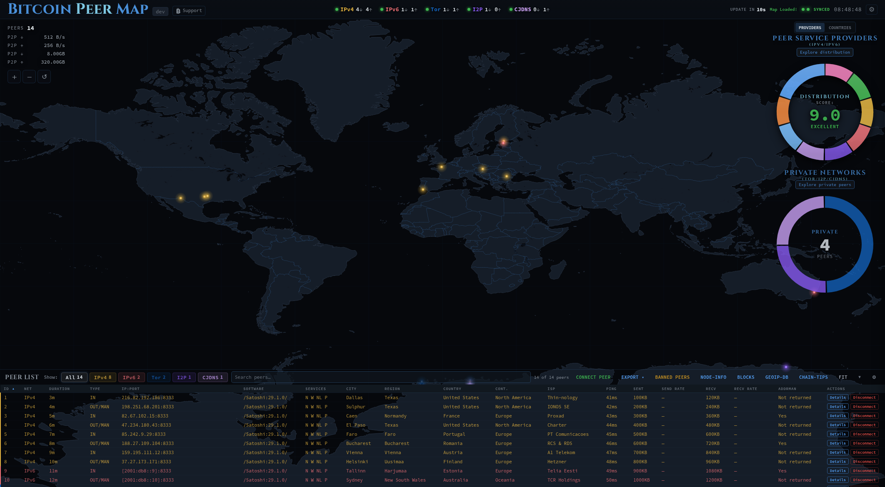

# Bitcoin Peer Map

A dashboard for monitoring and managing peers connected to a **Bitcoin Knots**
node. Explore your peers on a world map, compare networks and
service providers, and inspect node, block, and mempool information.

> **Node support:** This project focuses on Bitcoin Knots. Bitcoin Core is no
> longer supported.



Example dashboard using demo data.

- Explore public peers on the map and inspect Tor, I2P, and CJDNS connections.
- Compare countries and service providers, and inspect node and mempool information.
- Search and filter peers, view bandwidth rates, and export matches as CSV or JSON.
- Connect, disconnect, and ban peers from the dashboard.
- Cache peer locations locally and control external GeoIP lookups.

See the [dashboard guide](docs/dashboard.md) for controls and how to interpret
peer data.

## Requirements

- Docker Engine with Docker Compose.
- A Bitcoin Knots node with a reachable JSON-RPC endpoint.
- Dedicated RPC credentials for the dashboard.

The node can run on another machine or in another Compose project. Published
images support Linux AMD64 and ARM64.

## Quick start

### 1. Create a Compose configuration

Create `compose.yaml` in a directory of your choice:

```yaml
name: bitcoin-peer-map

services:
  bpm:
    image: ${BPM_IMAGE:-ghcr.io/spyhunter493/bitcoin-peer-map:latest}
    restart: unless-stopped
    init: true
    read_only: true
    cap_drop: [ALL]
    security_opt: [no-new-privileges:true]
    env_file: .env
    environment:
      BPM_LISTEN_ADDRESS: 0.0.0.0
      BPM_LISTEN_PORT: ${BPM_LISTEN_PORT:-58333}
      BPM_DATA_DIR: /var/lib/bitcoin-peer-map
    ports:
      - target: ${BPM_LISTEN_PORT:-58333}
        published: "${BPM_HOST_PORT:-58333}"
        host_ip: ${BPM_HOST_BIND:-0.0.0.0}
        protocol: tcp
    volumes:
      - bpm-data:/var/lib/bitcoin-peer-map
    tmpfs:
      - /tmp:rw,noexec,nosuid,size=64m,mode=1777
    logging:
      driver: json-file
      options:
        max-size: "10m"
        max-file: "3"
    stop_grace_period: 15s

volumes:
  bpm-data:
    name: ${BPM_DATA_VOLUME:-bitcoin-peer-map-data}
```

This uses the published image from
[GitHub Container Registry](https://github.com/spyhunter493/Bitcoin-Peer-Map/pkgs/container/bitcoin-peer-map)
and keeps saved data in a named volume. No repository checkout or local build is
needed.

### 2. Configure RPC and viewing access

Create `.env` next to `compose.yaml` with your node's RPC settings and a long,
random viewing token:

```env
BITCOIN_RPC_HOST=192.168.1.10
BITCOIN_RPC_USER=bpm
BITCOIN_RPC_PASSWORD=replace-with-a-long-random-password
BPM_VIEW_TOKEN=replace-with-a-long-random-viewing-token
```

Protect the file with `chmod 600 .env`. Add other settings to this file as needed;
see [configuration](docs/configuration.md).

Your node must allow RPC connections from the dashboard. See the
[RPC setup guide](docs/configuration.md#bitcoin-rpc) if RPC is not configured yet.
For a node in another Compose project, see
[shared Docker networks](docs/configuration.md#another-compose-project).

Viewing is private by default and requires a token before the service can start.
Management is disabled unless you also set `BPM_ADMIN_TOKEN`; use a different
token from `BPM_VIEW_TOKEN`. Use HTTPS when sending credentials. See
[access configuration](docs/configuration.md#viewing-access) for public/redacted
viewing and [management access](docs/configuration.md#admin-token-and-read-only-mode).

Optional server internet requests are off by default. RPC and cached GeoIP data
still work; a new install needs a dataset or external lookup opt-in to locate
public peers. An administrator can enable these in **GEOIP-DB**. External peer
lookups use free ip-api over unencrypted HTTP and require a separate opt-in. See
[GeoIP and outbound settings](docs/operations.md#geoip-updates-and-privacy).

### 3. Pull the image and start the dashboard

```bash
docker compose pull bpm
docker compose up -d bpm
```

Open **`http://HOST_IP:58333`**, replacing `HOST_IP` with the Docker host's address,
and enter your viewing token. Set `BPM_HOST_PORT` in `.env` to change the port.
The browser remembers access for 30 days, until you lock the view or the service
restarts.

## Updating

Pull the latest image and recreate the service:

```bash
docker compose pull bpm
docker compose up -d bpm
```

Keep the existing data volume to preserve peer locations and server preferences.
Images are published by stable GitHub Releases; merging into `main` does not
publish an image. See [operations](docs/operations.md) for version pinning,
update notices, backups, and troubleshooting.

## Documentation

| Guide | What it covers |
| --- | --- |
| [Dashboard](docs/dashboard.md) | Maps, private peers, search, filters, exports, metrics, and management |
| [Configuration](docs/configuration.md) | RPC, viewing/admin access, networking, environment variables, and secrets |
| [Operations](docs/operations.md) | Updates, logs, health, backups, GeoIP settings, and troubleshooting |
| [Development](docs/development.md) | Local builds, tests, and contributing |

Technical references: [architecture](docs/architecture.md), [API](docs/api.md),
[access control](docs/access-control.md), [browser security](docs/browser-security.md),
and [releasing](docs/releasing.md).

## License

[MIT](LICENSE). Inspired by [mbhillrn](https://github.com/mbhillrn) and
[Mirobit](https://github.com/Mirobit).
